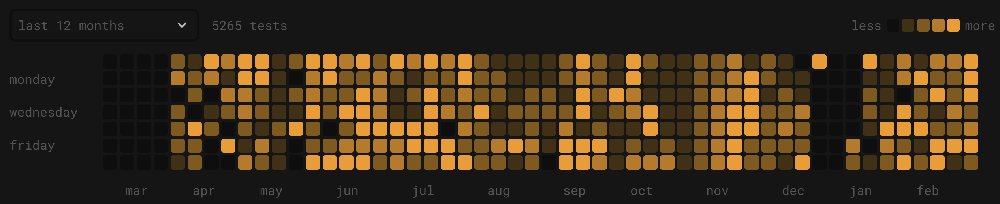

<h1 align="center">Hi, I'm KarnVen 👋</h1>

  

A bit more about me:

- 👨💻 I'm a **Full-Stack Developer** building end-to-end applications with a focus on clean code and great user experiences.
- 🤖 I love architecting **AI Agents** and creating intricate **n8n workflows** to automate tasks and boost productivity.
- 🏆 I'm an avid **hackathon participant** and a firm believer in learning by doing. I thrive under pressure and enjoy collaborating to bring ideas to life.
- 🌱 Beyond the keyboard, I'm a lifelong learner. You can find me reading a new book, practicing calisthenics, learning a new song on the guitar, or experimenting in the kitchen

 

  
  
  
  
  
  
  
  
  
  
  
  
  
  
  
  
  
  
  
  
  
  
  
  
  
  
  
  

 

<table width="100%">
<tr>
<td width="55%" valign="top">

<h3>⚡ Experience</h3>

<table width="100%" cellpadding="6">
<tr>
<td align="left">

**🏢 [EasyTax Global IT Solutions](https://easytax.live)** 
Developer · Apr 2026 – Present 
↳ Rebuilt Laravel 11 multi-portal platform 
↳ Built **[e-Mitra Integration](https://github.com/karnVen/eaystax_emitra)** & Drupal redesign 
`Laravel` `PHP` `Drupal` `MySQL` `AWS`

</td>
</tr>
<tr>
<td align="left">

**🌐 [Savings Yogi](https://savingsyogi.com)** 
Technical Solutions Intern · Feb – Mar 2026 
↳ Full FinTech app — zero to production 
↳ Headless Sanity CMS & 60 FPS Recharts 
↳ **[Case Study](https://github.com/karnVen/savingsyogi-fintech-showcase)** · **[Live Demo ↗](https://karnven.github.io/savingsyogi/)** 
`React` `TypeScript` `Sanity` `Recharts`

</td>
</tr>
</table>

 

<h3>🚀 Client & Freelance</h3>

<table width="100%" cellpadding="6">
<tr>
<td align="left">

🌿 **[ASMS Healthcare Platform](https://github.com/karnVen/asms-healthcare-platform)** &nbsp;[Live ↗](https://asms-iota.vercel.app/) 
AYUSH Shubham Institute · Section-8 Trust 
Next.js 15 clinical portal, 36-state GIS map & verification engine. 
`Next.js 15` `TypeScript` `Tailwind CSS`

</td>
</tr>
<tr>
<td align="left">

👗 **[Shree Shyam Designer](https://github.com/karnVen/shree-shyam-couture-platform)** &nbsp;[Live ↗](https://shree-shyam-designs.vercel.app/) 
Luxury Ethnic Couture Atelier, Jaipur 
Serverless e-commerce & WhatsApp sales engine. 
`Next.js 15` `React 19` `Neon Postgres`

</td>
</tr>
<tr>
<td align="left">

🤝 **[Nasiba Foundation](https://github.com/karnVen/nasiba-foundation-welfare-platform)** 
Humanitarian Welfare Trust 
Full-stack NGO platform & 4-tier staff ERP. 
`Next.js` `Prisma ORM` `JWT`

</td>
</tr>
</table>

 

<h3>🛠️ Projects</h3>

<table width="100%" cellpadding="6">
<tr>
<td align="left">

🐚 **[kaiVen (ShellOrigin)](https://github.com/karnVen/ShellOrigin)** 
Raw Unix shell in C with POSIX process isolation.

</td>
</tr>
<tr>
<td align="left">

🤖 **[GitPost](https://github.com/karnVen/GitPost)** 
Turns git commits into structured LinkedIn updates.

</td>
</tr>
<tr>
<td align="left">

⚡ **[NichijouVen](https://github.com/karnVen/NichijouVen)** 
Personal Life OS & habit mastery (Prisma + Docker).

</td>
</tr>
</table>

 

<h3>🏆 Hackathons & Early Builds</h3>

<table width="100%" cellpadding="6">
<tr>
<td align="left">

🛰️ **[GreenClaim Verify](https://github.com/KhushChouhan/greenclaim-verify)** (Hackathon) 
Auditing carbon claims via Sentinel-2 satellite data + Cesium 3D.

</td>
</tr>
<tr>
<td align="left">

🎓 **[EduVen](https://github.com/karnVen/EduVen)** (Built in 1st Year) 
Gamified learning portal replacing static PDFs.

</td>
</tr>
<tr>
<td align="left">

🐾 **[PAWRESCUE](https://github.com/karnVen/PAWRESCUE)** (Built in 1st Year) 
Pet adoption & animal rescue landing platform.

</td>
</tr>
<tr>
<td align="left">

🛡️ **[Women Safety Dashboard](https://github.com/karnVen/womenSeftyDashboard)** (Built in 1st Year) 
Mobile SOS dispatch & geofencing app in Flutter.

</td>
</tr>
</table>

</td>
<td width="45%" valign="top" align="center">

 
 

&nbsp;
&nbsp;
&nbsp;

 
 

 
 

<kbd>MonkeyType</kbd> <code>🔥 198d Max • ⚡ 50d Cur • 🚀 98wpm Best</code>

 

 

</td>
</tr>
</table>

 

  <picture>
    <source media="(prefers-color-scheme: dark)" srcset="https://raw.githubusercontent.com/karnVen/karnVen/output/pacman-contribution-graph-dark.svg" />
    <source media="(prefers-color-scheme: light)" srcset="https://raw.githubusercontent.com/karnVen/karnVen/output/pacman-contribution-graph.svg" />
    
  </picture>

